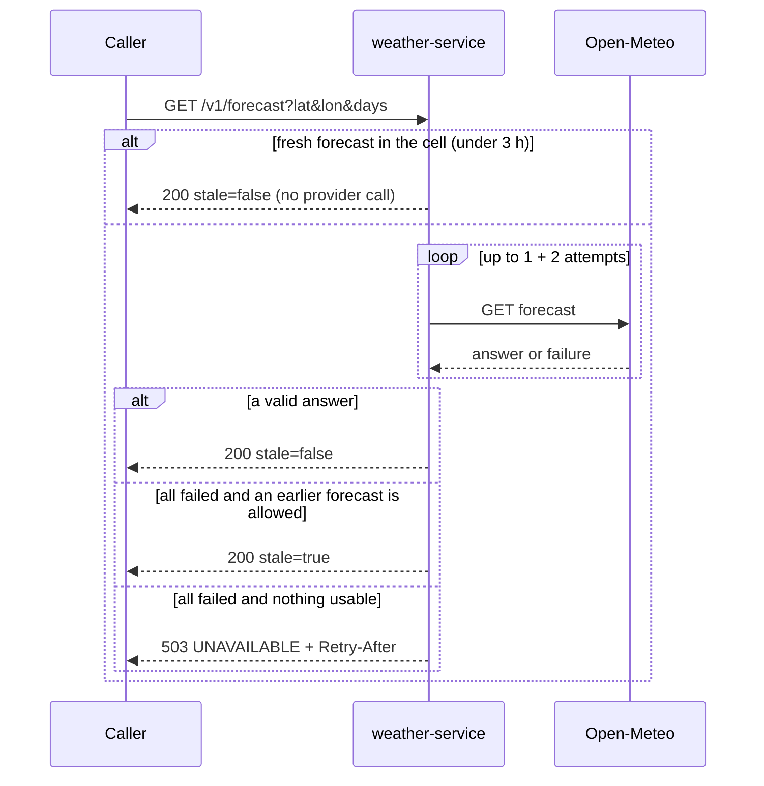

# weather-service

Serves the daily forecast (ET0 and rain) for a point. It knows coordinates and dates, nothing about farms, plots or crops. The data comes from [Open-Meteo](https://open-meteo.com/en/docs) and is cached in the memory of the process. There is no database: a restart empties the cache, and the next request fetches again.

## Run it

From `services/weather-service`:

```bash
uv sync
cp .env.example .env     # every variable except PROVIDER_API_KEY is required
uv run uvicorn main:app --host 127.0.0.1 --port 8001
uv run pytest
```

If a required variable is missing, the service stops at startup and lists the missing names.

## API

`GET /v1/forecast?lat={lat}&lon={lon}&days={days}`

- `lat` -90 to 90, `lon` -180 to 180, `days` 1 to 7 (default 7). Anything else is 422 `VALIDATION`.
- The days start today, in the local time of the point.

```json
{
  "lat": 31.25,
  "lon": 34.79,
  "source": "open-meteo",
  "fetched_at": "2026-11-16T15:24:50Z",
  "stale": false,
  "days": [
    { "date": "2026-11-16", "et0_mm": 2.76, "rain_mm": 0.0 },
    { "date": "2026-11-17", "et0_mm": 2.63, "rain_mm": 0.0 }
  ]
}
```

`lat` and `lon` repeat the request. The numbers are for the 0.1 degree cell that contains the point.

`GET /health` returns `{"status": "ok"}`.

Errors are `application/problem+json` with a `code`: `VALIDATION` (422) or `UNAVAILABLE` (503, with a `Retry-After` header).

## Where the numbers come from

| Our field | Open-Meteo daily variable | Unit |
|---|---|---|
| `et0_mm` | `et0_fao_evapotranspiration` | mm. "ET0 reference evapotranspiration of a well watered grass field", FAO-56 Penman-Monteith. |
| `rain_mm` | `precipitation_sum` | mm. Sum of rain, showers and snowfall (in water equivalent). |

Other facts from the Open-Meteo docs, checked on 2026-11-16 (the docs page and a real call):

- Request: `daily=et0_fao_evapotranspiration,precipitation_sum&forecast_days=7&timezone=auto`. The docs say `timezone` is needed when daily variables are requested. `auto` takes the time zone from the coordinates, so the dates are local dates.
- The response has `daily_units`. We check that both are `mm` and treat anything else as a provider failure.
- The free tier needs no API key and is for non-commercial use (10,000 calls a day). A paid plan uses the host `customer-api.open-meteo.com` and the parameter `apikey`. Switching is a change to `PROVIDER_BASE_URL` and `PROVIDER_API_KEY` in `.env`.
- `rain_mm` uses `precipitation_sum` and not `rain_sum` because snow also puts water in the soil. If you want rain only, change `RAIN_FIELD` in `provider.py`.

Open-Meteo's names exist only in `provider.py`. Changing the provider means changing that one file.

## How it works

- **Cell.** A point belongs to a 0.1 degree cell (about 11 km): each coordinate is rounded down to a tenth. Two points in one cell share one forecast. The provider is asked about the center of the cell.
- **Fresh.** A forecast younger than `FORECAST_FRESH_SECONDS` (3 hours) is served without calling the provider. The service always fetches a full 7 days and cuts out the days requested.
- **One call per cell.** When many requests wait for the same cell, only one calls the provider.
- **Retry.** If the provider fails (timeout, error status, a body that is not JSON, a missing or invalid value, units other than mm, or not 7 consecutive days) the call is repeated `PROVIDER_RETRIES` times (2 retries, so up to 3 calls).
- **Stale.** If all attempts fail and the cell has an earlier forecast that is still allowed (see below), it is served with `stale: true`. `fetched_at` stays the time of the old fetch, so the caller sees how old it is.
- **503.** If all attempts fail and there is no usable earlier forecast, the answer is 503 `UNAVAILABLE` with `Retry-After`.

**No invented numbers.** A `null`, a missing day, a string or a negative value from the provider is a provider failure. It goes through the retry, stale and 503 path. The service never fills in a zero or a default. A `0.0` that the provider sends is real data and is passed on.



## How old can a stale forecast be

**24 hours** (`FORECAST_MAX_STALE_SECONDS=86400`). Why:

- Weather forecasts for the next days change slowly, so a forecast from a few hours ago is still much better than none. A 24 hour limit covers a provider outage that lasts a night.
- After a day the first dates have passed and the numbers for the coming days have moved. A plan built on that would look reliable and not be. A clear 503 is better than that.
- The limit is in `.env`, so you can change it without code.

A stale forecast is also dropped when it can no longer give the days asked for. After local midnight a cached week has 6 days left, so a request for 7 days gets 503 and a request for 6 or fewer days is still answered. The service never answers with fewer days than asked, and never pads.

## Settings (`.env`)

| Variable | Meaning | Example |
|---|---|---|
| `PROVIDER_BASE_URL` | Provider URL | `https://api.open-meteo.com/v1/forecast` |
| `PROVIDER_API_KEY` | API key, may be empty | |
| `PROVIDER_TIMEOUT_SECONDS` | Timeout of one provider call | `5` |
| `PROVIDER_RETRIES` | Extra attempts after a failure | `2` |
| `FORECAST_FRESH_SECONDS` | How long a forecast is fresh | `10800` |
| `FORECAST_MAX_STALE_SECONDS` | Oldest forecast served as stale | `86400` |
| `RETRY_AFTER_SECONDS` | `Retry-After` value on a 503 | `60` |

`Retry-After` is 60 seconds: the provider has already been tried three times, so trying again at once would not help.

## Performance

Fresh forecast (served from the cache, no provider call), 10 requests per second for 30 seconds, one local client, 0 errors:

| Request | p95 |
|---|---|
| `days=7` | 15.9 ms |
| `days=1` | 16.3 ms |

The target is p95 at or below 100 ms.

## Layout

- `main.py`: routes, validation and error handling.
- `forecast.py`: the cell cache, freshness, retries, stale and 503 logic.
- `provider.py`: the Open-Meteo client and the check of its answer. The only file that knows Open-Meteo.
- `config.py`: settings, read with pydantic-settings.
- `tests/`: automated tests. The provider is replaced by a fake, so they never call the internet.
